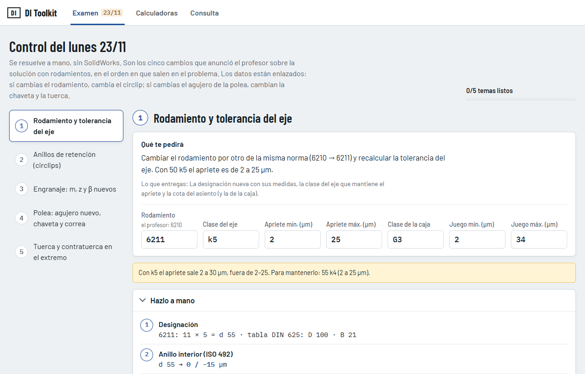
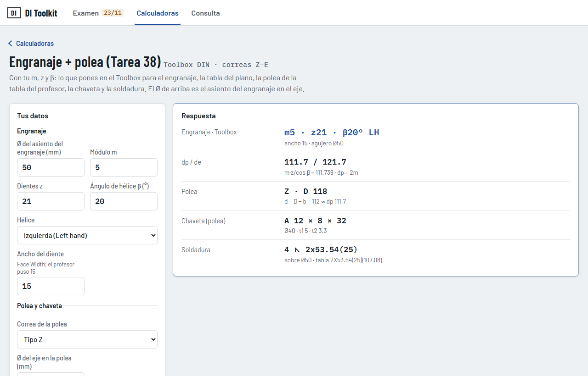
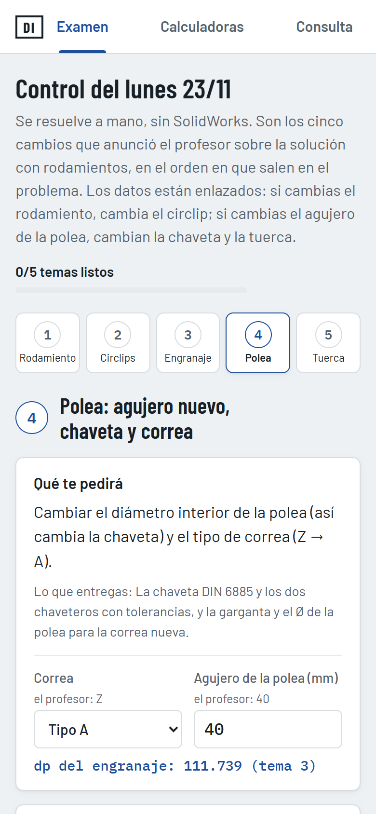

# DI Toolkit

Calculadoras de **Dibujo Industrial** que no se limitan a dar el número: enseñan **cómo se hace a mano**, **cómo queda el croquis** y **qué se escribe en el plano**.

**👉 Ábrelo aquí: [poisdom.github.io/di-toolkit](https://poisdom.github.io/di-toolkit/)**

Funciona en el ordenador y en el móvil, sin cuenta y sin instalar nada. En el móvil, «Añadir a pantalla de inicio» lo deja como una app. Lo que escribes se guarda en tu navegador, así que cada persona tiene sus propios datos.



## Qué hay dentro

### Examen
Los cinco cambios del control del 23/11, en el orden en que salen en el problema. Cada tema explica qué te pedirán y luego da los pasos a mano, la respuesta para comprobarla, el croquis y lo que va en el plano. Los datos están enlazados: si cambias el rodamiento cambia el circlip, y si cambias el agujero de la polea cambian la chaveta y la tuerca. Marca «Ya sé hacerlo» en cada tema para llevar la cuenta.

1. Rodamiento y tolerancia del eje
2. Anillos de retención (circlips)
3. Engranaje: m, z y β nuevos
4. Polea: agujero nuevo, chaveta y correa
5. Tuerca y contratuerca en el extremo

### Calculadoras

| Calculadora | Norma | Qué te da |
|---|---|---|
| Ajuste agujero–eje | ISO 286 | Desviaciones, juego o apriete, y la cota con tolerancia |
| Chaveta paralela | DIN 6885-1 | Chaveta y chaveteros del eje y de la polea |
| Anillo de seguridad (circlip) | DIN 471 | Anillo para ejes y su ranura |
| Soldadura intermitente | ISO 2553 | Cordones alrededor del eje y su símbolo |
| Tuerca + contratuerca | ISO 4032 / 4035 | Rosca del extremo del eje, tuercas y largos |
| Engranaje + polea | Toolbox DIN · correas Z–E | Engranaje helicoidal, polea trapecial, chaveta y soldadura |
| Rodamiento + tolerancia del eje | DIN 625 / 628 · ISO 492 | Medidas, clase del eje y de la caja para el apriete pedido |

Cada página tiene arriba tus datos y la respuesta. Debajo, en secciones que se abren y se cierran, están el método a mano, el croquis, lo que escribes en el plano y de qué norma sale cada número.

<p>
  
  
</p>

### Consulta
- **Tabla Ø 7–200**: chaveta, circlip, h9 / D10 y soldadura para cada diámetro.
- **Antes de entregar**: lista de comprobación del plano y de los archivos.
- **Ejercicio guiado del Control 2**: tus medidas, los pasos en SolidWorks y el ejemplo del profesor.

## Usarlo sin internet
Descarga el ZIP (botón verde **Code → Download ZIP**), descomprímelo y abre `index.html`. Sin internet funciona igual, solo cambia la tipografía.

## ¿Son fiables los números?
Cada calculadora se comprueba con más de 8.500 casos conocidos (`node test.js`), sacados de las tablas de las normas y de las soluciones del curso. Aun así, es una ayuda para estudiar, no material oficial: si algo no te cuadra con los apuntes, manda lo de los apuntes. Si encuentras un error, [abre un issue](https://github.com/Poisdom/di-toolkit/issues).

## Para quien quiera tocar el código
HTML, CSS y JavaScript sin dependencias ni compilación: abre `index.html` y ya está.

```
index.html       vistas
style.css        estilos (tema claro y oscuro)
app.js           navegación, páginas de calculadora y del examen
engine.js        cálculo puro: ISO 286, DIN 6885, DIN 471, soldadura
exam.js          los temas del examen sobre un solo juego de datos
calc/<id>.js     una calculadora por archivo (calc/_kit.js = utilidades comunes)
test.js, test/   casos conocidos (node test.js)
```

Para añadir una calculadora, copia `calc/anillo.js`, cambia `id`, `form`, `run` y `mano`, y añade su `<script>` en `index.html`. La lista, la ruta y los datos guardados salen solos. Después ejecuta `node test.js`.

## Créditos
Hecho por [Poisdom](https://github.com/Poisdom) para la asignatura de Dibujo Industrial del IQS (curso 2026-27). Las imágenes de `img/` son del ejemplo resuelto del curso y pertenecen a sus autores.

Todos los derechos reservados: puedes usarlo y compartir el enlace, pero pregunta antes de copiar el código para otro proyecto.
